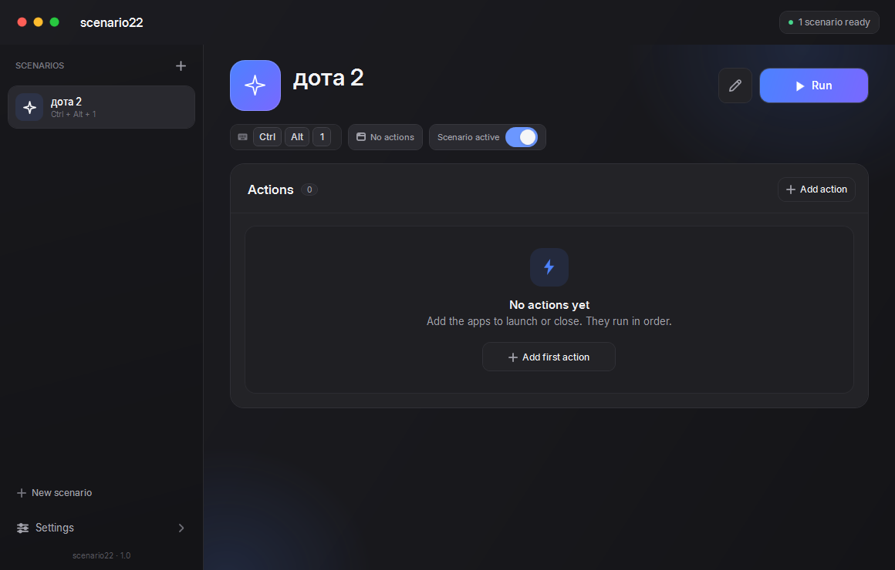

# scenario22

Настольное приложение для Windows на WPF, которое управляет сценариями запуска и закрытия программ. Вы собираете набор действий «открыть/закрыть» — например «Игровой режим», — назначаете глобальную горячую клавишу и запускаете их одним нажатием из любого приложения. Интерфейс — на английском по умолчанию, русский включается в настройках.



## Возможности

- **Сценарии** — набор действий, выполняемых по порядку: запуск приложений, ярлыков, документов и ссылок (в т.ч. `steam://…`), закрытие процессов по имени.
- **Глобальные горячие клавиши** — работают, даже когда окно свёрнуто в трей; индикатор готовности и подсказка о конфликтах сочетаний.
- **Своя иконка сценария** — белые векторные иконки из палитры или собственное изображение (png/jpg/ico/exe/lnk).
- **Свой цвет** — 6 готовых палитр плюс любой собственный градиент.
- **Задержки** — у каждого действия пауза 0–600 секунд.
- **Трей** — меню с быстрым запуском сценариев, настройками и выходом; закрытие окна сворачивает в трей.
- **Темы** — светлая и тёмная, с мягкой подсветкой страницы активного сценария.
- **Тосты** — прогресс выполнения и результат с отчётом об ошибках.

## Требования

- Windows 10 1709+ (квадратные углы — на Windows 11)
- [.NET 8 SDK](https://dotnet.microsoft.com/download/dotnet/8.0) — только для сборки

## Сборка и запуск

```powershell
git clone https://github.com/wintence/scenario22.git
cd scenario22
dotnet build scenario22\scenario22.csproj
dotnet run --project scenario22\scenario22.csproj
```

Публикация переносимой версии:

```powershell
dotnet publish scenario22\scenario22.csproj -c Release -r win-x64 --self-contained false
```

Готовая сборка лежит в `bin\Release\net8.0-windows\win-x64\publish`.

## Хранение данных

Настройки и сценарии хранятся только на вашем компьютере — в `%APPDATA%\scenario22\settings.json`. Если файл повреждён, программа сохраняет его копию рядом (`settings.json.broken-*`) и создаёт начальное состояние.

## Безопасность закрытия процессов

Ряд системных процессов (`explorer`, `csrss`, `lsass`, `svchost`, `dwm` и др.) защита не позволяет закрывать сценариями — эту защиту не ослабляйте и не отключайте.

## Структура проекта

```text
scenario22/
├── App.xaml(.cs)          — точка входа, single-instance mutex, обработка исключений
├── MainWindow.xaml(.cs)   — главное окно и основная логика UI
├── ToastWindow.xaml(.cs)  — всплывающие уведомления
├── Models/                — Scenario, ScenarioAction, Hotkey, AppState, палитра
├── Services/              — запуск сценариев, настройки, хоткеи, трей, темы
├── Sheets/                — диалоги действий и сценариев
├── Controls/HotkeyBox     — ввод сочетания клавиш
└── Themes/                — Dark.xaml, Light.xaml, Styles.xaml, Icons.xaml
```

## Лицензия

MIT — см. [LICENSE](LICENSE).
